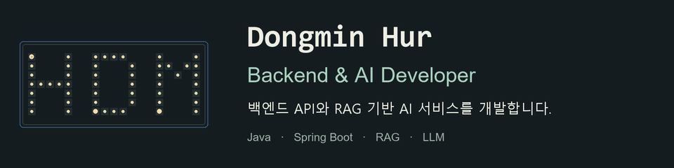
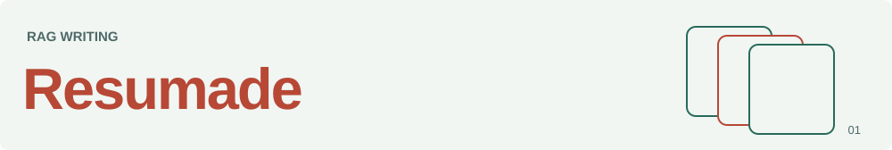
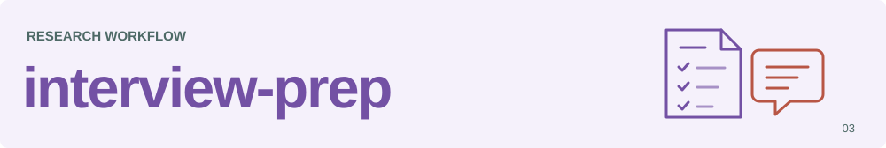
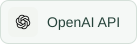
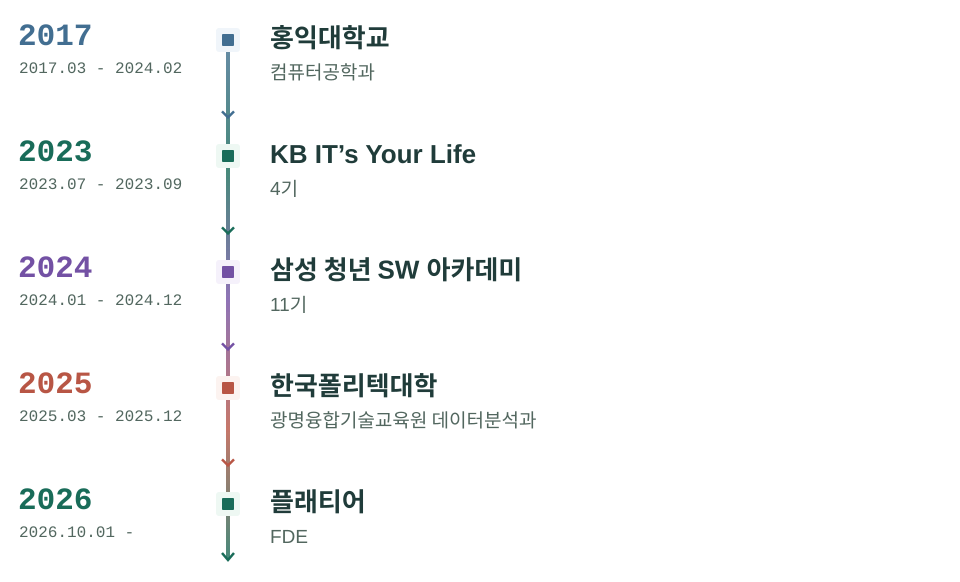
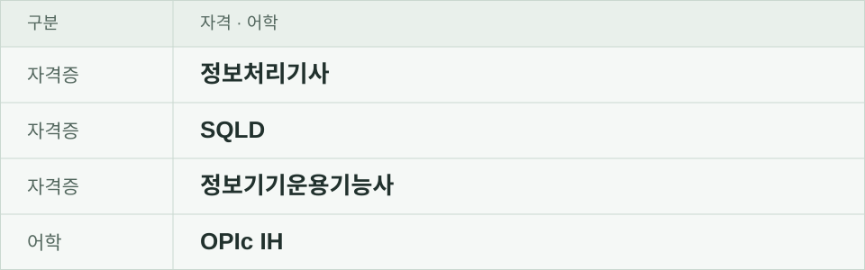
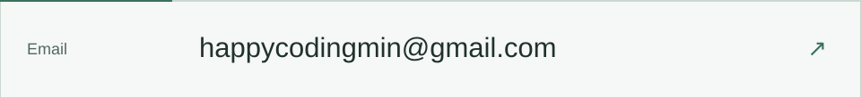

<picture>
  <source media="(prefers-color-scheme: light) and (prefers-reduced-motion: reduce) and (max-width: 600px)" srcset="assets/header-mobile-light.png">
  <source media="(prefers-color-scheme: light) and (prefers-reduced-motion: reduce)" srcset="assets/header-light.png">
  <source media="(prefers-reduced-motion: reduce) and (max-width: 600px)" srcset="assets/header-mobile-dark.png">
  <source media="(prefers-reduced-motion: reduce)" srcset="assets/header-dark.png">
  <source media="(prefers-color-scheme: light) and (max-width: 600px)" srcset="assets/header-mobile-light.gif">
  <source media="(prefers-color-scheme: light)" srcset="assets/header-light.gif">
  <source media="(max-width: 600px)" srcset="assets/header-mobile-dark.gif">
  
</picture>

## Projects

<a href="https://github.com/HurDong/Resumade">
<picture>
  <source media="(prefers-color-scheme: dark)" srcset="assets/resumade-dark.svg">
  <source media="(prefers-color-scheme: light)" srcset="assets/resumade-light.svg">
  
</picture>
</a>

경험과 채용공고에서 필요한 내용을 찾아 자기소개서를 쓰고 검토하는 데 활용하는 RAG 서비스입니다.

`Spring Boot` `Elasticsearch` `LangChain4j`

<a href="https://github.com/HurDong/HanaZoom">
<picture>
  <source media="(prefers-color-scheme: dark)" srcset="assets/hana-dark.svg">
  <source media="(prefers-color-scheme: light)" srcset="assets/hana-light.svg">
  
</picture>
</a>

지역별 주식 투자 동향을 지도에서 보고, 다른 투자자와 실시간으로 대화할 수 있는 서비스입니다.

`Spring Boot` `Kafka` `WebSocket`

<a href="https://github.com/HurDong/interview-prep-skill">
<picture>
  <source media="(prefers-color-scheme: dark)" srcset="assets/prep-dark.svg">
  <source media="(prefers-color-scheme: light)" srcset="assets/prep-light.svg">
  
</picture>
</a>

채용공고와 지원서를 참고해 면접 자료를 조사하고 검증합니다. 사용자가 승인하면 Notion에 준비 페이지를 만드는 Codex 스킬입니다.

`Python` `Codex` `Notion`

## More Projects

- **[TIKKLE](https://github.com/HurDong/tikkle)**: 시간을 재화로 삼아 도움을 주고받는 서비스입니다. 1:1 채팅과 채팅 이력 기능을 개발했습니다.
- **[Fastats](https://github.com/HurDong/fastats)**: KOSIS 통계를 검색하는 서비스입니다. 한국어 검색을 개선하고 데이터 처리 기능을 개발했습니다.
- **[CodeGenie](https://github.com/HurDong/CodeGenie)**: AI와 함께 코딩테스트 문제를 풀어보는 도구입니다. 문제 해석, 풀이, 반례 찾기와 디버깅을 돕습니다.

## Tech Stack

프로젝트에서 사용한 기술과 도구입니다.

**Backend**

<picture><source media="(prefers-color-scheme: dark)" srcset="assets/badge-java-dark.svg"><source media="(prefers-color-scheme: light)" srcset="assets/badge-java-light.svg"></picture> <picture><source media="(prefers-color-scheme: dark)" srcset="assets/badge-spring-boot-dark.svg"><source media="(prefers-color-scheme: light)" srcset="assets/badge-spring-boot-light.svg"></picture> <picture><source media="(prefers-color-scheme: dark)" srcset="assets/badge-spring-cloud-dark.svg"><source media="(prefers-color-scheme: light)" srcset="assets/badge-spring-cloud-light.svg"></picture> <picture><source media="(prefers-color-scheme: dark)" srcset="assets/badge-spring-security-dark.svg"><source media="(prefers-color-scheme: light)" srcset="assets/badge-spring-security-light.svg"></picture> <picture><source media="(prefers-color-scheme: dark)" srcset="assets/badge-jpa-dark.svg"><source media="(prefers-color-scheme: light)" srcset="assets/badge-jpa-light.svg"></picture> <picture><source media="(prefers-color-scheme: dark)" srcset="assets/badge-spring-webflux-dark.svg"><source media="(prefers-color-scheme: light)" srcset="assets/badge-spring-webflux-light.svg"></picture> <picture><source media="(prefers-color-scheme: dark)" srcset="assets/badge-jwt-dark.svg"><source media="(prefers-color-scheme: light)" srcset="assets/badge-jwt-light.svg"></picture>

**Data & Messaging**

<picture><source media="(prefers-color-scheme: dark)" srcset="assets/badge-postgresql-dark.svg"><source media="(prefers-color-scheme: light)" srcset="assets/badge-postgresql-light.svg"></picture> <picture><source media="(prefers-color-scheme: dark)" srcset="assets/badge-mysql-dark.svg"><source media="(prefers-color-scheme: light)" srcset="assets/badge-mysql-light.svg"></picture> <picture><source media="(prefers-color-scheme: dark)" srcset="assets/badge-mariadb-dark.svg"><source media="(prefers-color-scheme: light)" srcset="assets/badge-mariadb-light.svg"></picture> <picture><source media="(prefers-color-scheme: dark)" srcset="assets/badge-oracle-dark.svg"><source media="(prefers-color-scheme: light)" srcset="assets/badge-oracle-light.svg"></picture> <picture><source media="(prefers-color-scheme: dark)" srcset="assets/badge-mongodb-dark.svg"><source media="(prefers-color-scheme: light)" srcset="assets/badge-mongodb-light.svg"></picture> <picture><source media="(prefers-color-scheme: dark)" srcset="assets/badge-redis-dark.svg"><source media="(prefers-color-scheme: light)" srcset="assets/badge-redis-light.svg"></picture> <picture><source media="(prefers-color-scheme: dark)" srcset="assets/badge-elasticsearch-dark.svg"><source media="(prefers-color-scheme: light)" srcset="assets/badge-elasticsearch-light.svg"></picture> <picture><source media="(prefers-color-scheme: dark)" srcset="assets/badge-kafka-dark.svg"><source media="(prefers-color-scheme: light)" srcset="assets/badge-kafka-light.svg"></picture> <picture><source media="(prefers-color-scheme: dark)" srcset="assets/badge-rabbitmq-dark.svg"><source media="(prefers-color-scheme: light)" srcset="assets/badge-rabbitmq-light.svg"></picture> <picture><source media="(prefers-color-scheme: dark)" srcset="assets/badge-websocket-dark.svg"><source media="(prefers-color-scheme: light)" srcset="assets/badge-websocket-light.svg"></picture>

**AI**

<picture><source media="(prefers-color-scheme: dark)" srcset="assets/badge-langchain4j-dark.svg"><source media="(prefers-color-scheme: light)" srcset="assets/badge-langchain4j-light.svg"></picture> <picture><source media="(prefers-color-scheme: dark)" srcset="assets/badge-openai-api-dark.svg"><source media="(prefers-color-scheme: light)" srcset="assets/badge-openai-api-light.svg"></picture> <picture><source media="(prefers-color-scheme: dark)" srcset="assets/badge-python-dark.svg"><source media="(prefers-color-scheme: light)" srcset="assets/badge-python-light.svg"></picture> <picture><source media="(prefers-color-scheme: dark)" srcset="assets/badge-codex-skill-dark.svg"><source media="(prefers-color-scheme: light)" srcset="assets/badge-codex-skill-light.svg"></picture>

**Frontend**

<picture><source media="(prefers-color-scheme: dark)" srcset="assets/badge-html5-dark.svg"><source media="(prefers-color-scheme: light)" srcset="assets/badge-html5-light.svg"></picture> <picture><source media="(prefers-color-scheme: dark)" srcset="assets/badge-css3-dark.svg"><source media="(prefers-color-scheme: light)" srcset="assets/badge-css3-light.svg"></picture> <picture><source media="(prefers-color-scheme: dark)" srcset="assets/badge-javascript-dark.svg"><source media="(prefers-color-scheme: light)" srcset="assets/badge-javascript-light.svg"></picture> <picture><source media="(prefers-color-scheme: dark)" srcset="assets/badge-typescript-dark.svg"><source media="(prefers-color-scheme: light)" srcset="assets/badge-typescript-light.svg"></picture> <picture><source media="(prefers-color-scheme: dark)" srcset="assets/badge-react-dark.svg"><source media="(prefers-color-scheme: light)" srcset="assets/badge-react-light.svg"></picture> <picture><source media="(prefers-color-scheme: dark)" srcset="assets/badge-next-js-dark.svg"><source media="(prefers-color-scheme: light)" srcset="assets/badge-next-js-light.svg"></picture>

**DevOps & Tools**

<picture><source media="(prefers-color-scheme: dark)" srcset="assets/badge-docker-dark.svg"><source media="(prefers-color-scheme: light)" srcset="assets/badge-docker-light.svg"></picture> <picture><source media="(prefers-color-scheme: dark)" srcset="assets/badge-docker-compose-dark.svg"><source media="(prefers-color-scheme: light)" srcset="assets/badge-docker-compose-light.svg"></picture> <picture><source media="(prefers-color-scheme: dark)" srcset="assets/badge-gradle-dark.svg"><source media="(prefers-color-scheme: light)" srcset="assets/badge-gradle-light.svg"></picture> <picture><source media="(prefers-color-scheme: dark)" srcset="assets/badge-git-dark.svg"><source media="(prefers-color-scheme: light)" srcset="assets/badge-git-light.svg"></picture> <picture><source media="(prefers-color-scheme: dark)" srcset="assets/badge-github-dark.svg"><source media="(prefers-color-scheme: light)" srcset="assets/badge-github-light.svg"></picture> <picture><source media="(prefers-color-scheme: dark)" srcset="assets/badge-github-actions-dark.svg"><source media="(prefers-color-scheme: light)" srcset="assets/badge-github-actions-light.svg"></picture> <picture><source media="(prefers-color-scheme: dark)" srcset="assets/badge-jmeter-dark.svg"><source media="(prefers-color-scheme: light)" srcset="assets/badge-jmeter-light.svg"></picture> <picture><source media="(prefers-color-scheme: dark)" srcset="assets/badge-gatling-dark.svg"><source media="(prefers-color-scheme: light)" srcset="assets/badge-gatling-light.svg"></picture> <picture><source media="(prefers-color-scheme: dark)" srcset="assets/badge-aws-ec2-dark.svg"><source media="(prefers-color-scheme: light)" srcset="assets/badge-aws-ec2-light.svg"></picture> <picture><source media="(prefers-color-scheme: dark)" srcset="assets/badge-aws-rds-dark.svg"><source media="(prefers-color-scheme: light)" srcset="assets/badge-aws-rds-light.svg"></picture> <picture><source media="(prefers-color-scheme: dark)" srcset="assets/badge-aws-s3-dark.svg"><source media="(prefers-color-scheme: light)" srcset="assets/badge-aws-s3-light.svg"></picture>

## Background

<picture>
<source media="(prefers-color-scheme: dark) and (max-width: 600px)" srcset="assets/timeline-mobile-dark.svg">
<source media="(prefers-color-scheme: light) and (max-width: 600px)" srcset="assets/timeline-mobile-light.svg">
<source media="(prefers-color-scheme: dark)" srcset="assets/timeline-dark.svg">
<source media="(prefers-color-scheme: light)" srcset="assets/timeline-light.svg">

</picture>

### 자격 · 어학

<picture>
  <source media="(prefers-color-scheme: dark) and (max-width: 600px)" srcset="assets/credentials-mobile-dark.svg">
  <source media="(prefers-color-scheme: light) and (max-width: 600px)" srcset="assets/credentials-mobile-light.svg">
  <source media="(prefers-color-scheme: dark)" srcset="assets/credentials-dark.svg">
  <source media="(prefers-color-scheme: light)" srcset="assets/credentials-light.svg">
  
</picture>

## Activity

<picture>
  <source media="(prefers-color-scheme: dark)" srcset="https://github-profile-summary-cards.vercel.app/api/cards/stats?username=HurDong&amp;theme=github_dark">
  <source media="(prefers-color-scheme: light)" srcset="https://github-profile-summary-cards.vercel.app/api/cards/stats?username=HurDong&amp;theme=github">
  
</picture>

알고리즘 풀이 기록 → [Algorithm](https://github.com/HurDong/Algorithm)

---

<a href="mailto:happycodingmin@gmail.com"><picture>
  <source media="(prefers-color-scheme: dark)" srcset="assets/contact-email-dark.svg">
  <source media="(prefers-color-scheme: light)" srcset="assets/contact-email-light.svg">
  
</picture></a>
<a href="https://dongmin.vercel.app"><picture>
  <source media="(prefers-color-scheme: dark)" srcset="assets/contact-portfolio-dark.svg">
  <source media="(prefers-color-scheme: light)" srcset="assets/contact-portfolio-light.svg">
  
</picture></a>

